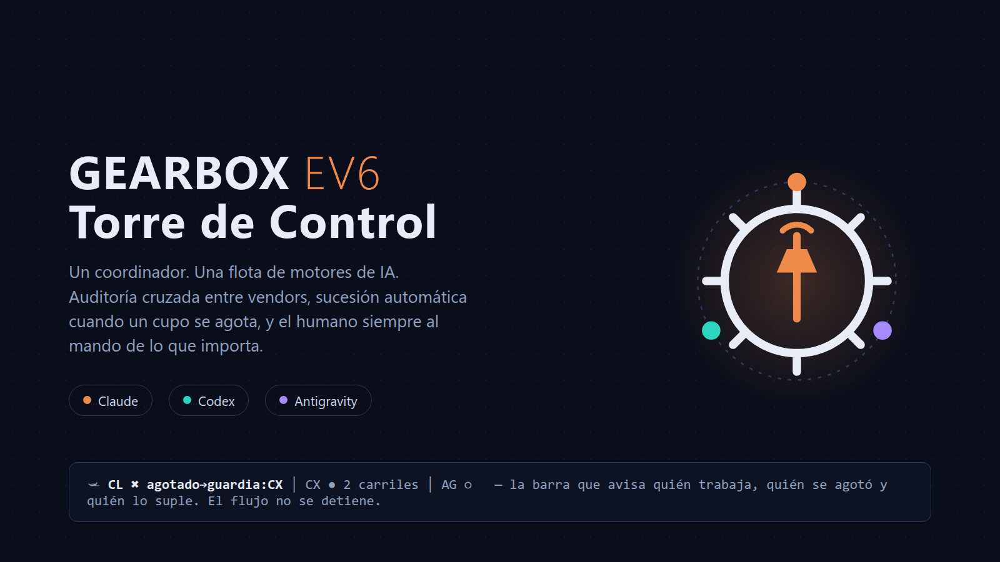
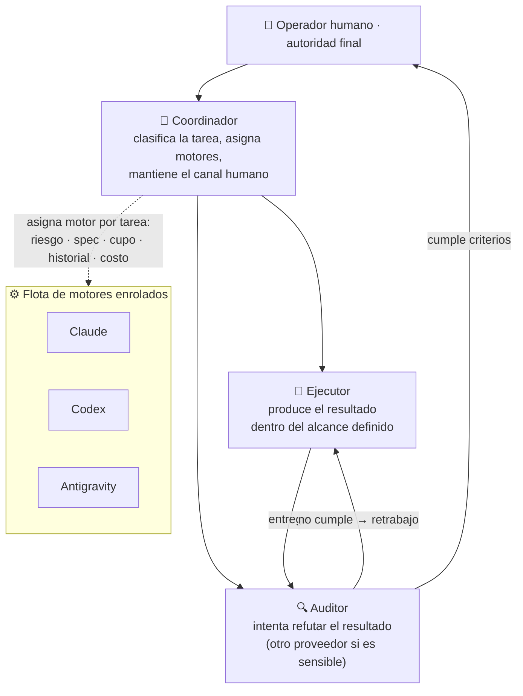
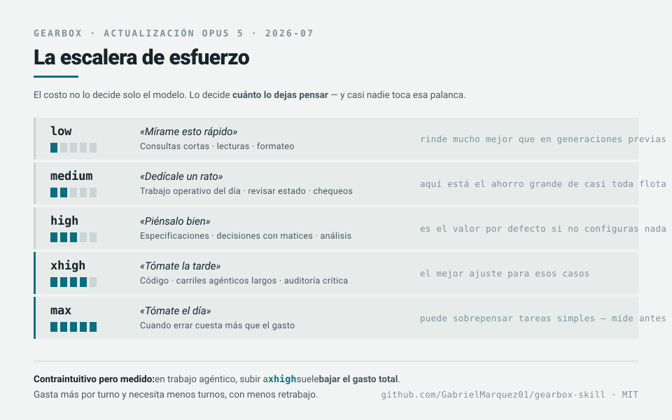

<div align="center">

Actualizado: 2026-11-07 00:29 (America/Mexico_City).



# Gearbox

**La marcha correcta y el motor correcto para cada tarea de IA — con auditoría cruzada y el humano como autoridad final.**

[](LICENSE)
[](docs/GEARBOX-EV6-MULTI-MOTOR.md#13-estado-y-alcance-del-proyecto)
[](docs/GEARBOX-EV6-MULTI-MOTOR.md)
[](#-contribuir--reportar-resultados)

</div>

---

Gearbox nació como un **skill para Claude Code** que clasifica cada tarea en una *marcha* de esfuerzo (G0–G5) y recomienda el modelo y el razonamiento adecuados **antes de gastar** — para dejar de pagar precio de modelo grande por trabajo de modelo chico, y de pagar retrabajos por correr lo difícil en el modelo barato.

**Gearbox EV6** es su evolución: una *torre de control* para equipos de IA **multi-motor**. Un coordinador asigna trabajo a distintos motores —hoy Claude, Codex y Antigravity— según tipo de tarea, esfuerzo, disponibilidad y desempeño medido. Todo flujo autónomo exige dos roles separados (**ejecutor + auditor**), y lo sensible —dinero, legal, fiscal, datos personales— exige **auditoría cruzada entre proveedores** y aprobación humana. En su primer día operativo, una auditoría cruzada con Codex detectó una omisión fiscal real (Regla Miscelánea 3.13.7) que la revisión primaria no vio.

Esto es **infraestructura temprana y honesta**: no comparte cuentas ni sesiones entre agentes, no promete que dos modelos siempre acierten, y documenta sus fricciones reales (sandbox de Windows, autorización headless, cupos poco visibles) para que sean **reproducibles y medibles**, no para esconderlas.

## 📑 Índice

- [Quick Start](#-quick-start)
- [Cómo se organiza la flota](#-cómo-se-organiza-la-flota)
- [Elegir el motor: por clase de tarea y por cupo real](#-elegir-el-motor-por-clase-de-tarea-y-por-cupo-real)
- [Las marchas G0–G5](#-las-marchas-g0g5)
- [¿Cuánto rinde? — con y sin Gearbox](#-cuánto-rinde--la-misma-cuenta-con-y-sin-gearbox) *(actualización oct-2026: familia Claude 5.x)*
- [Comparativa de motores](#-comparativa-de-motores) *(colapsable)*
- [FAQ](#-faq) *(colapsable)*
- [Documentación](#-documentación)
- [Contribuir / reportar resultados](#-contribuir--reportar-resultados)
- [Licencia](#-licencia)

**Documento técnico completo:** [Gearbox EV6 — Torre de Control multi-motor](docs/GEARBOX-EV6-MULTI-MOTOR.md)
→ [Qué problema resuelve](docs/GEARBOX-EV6-MULTI-MOTOR.md#1-qué-problema-intenta-resolver) · [Arquitectura en 5 minutos](docs/GEARBOX-EV6-MULTI-MOTOR.md#2-arquitectura-en-cinco-minutos) · [Guía de replicación](docs/GEARBOX-EV6-MULTI-MOTOR.md#4-guía-de-replicación) · [Modo mono-motor](docs/GEARBOX-EV6-MULTI-MOTOR.md#5-modo-mono-motor-empezar-solo-con-claude-code) · [El primer día (caso real)](docs/GEARBOX-EV6-MULTI-MOTOR.md#6-el-primer-día-una-omisión-fiscal-detectada-por-auditoría-cruzada) · [Fricciones reales](docs/GEARBOX-EV6-MULTI-MOTOR.md#8-fricciones-reales-encontradas) · [Cómo evaluar tu réplica](docs/GEARBOX-EV6-MULTI-MOTOR.md#10-cómo-evaluar-tu-propia-réplica) · [Invitación a la comunidad](docs/GEARBOX-EV6-MULTI-MOTOR.md#12-invitación-a-la-comunidad)

> **Limitaciones conocidas:** la bitácora puede generar JSON inválido ante bytes UTF-8
> incompletos, y el guardián opcional puede reutilizar lecturas de cupo vencidas. Comprueba
> `/usage` antes de continuar por un aviso del guardián. Las correcciones de código quedan
> para un parche separado; esta actualización no las acredita como resueltas.
> `prices.json` conserva el catálogo de julio de 2026; su actualización y la de los scripts
> `.sh` al catálogo Claude 5.x están **pendientes del parche de código separado**. Los IDs y
> tarifas fechados de esta documentación constan en [docs/FUENTES.md](docs/FUENTES.md).
> El `statusline.sh` de `066477c` tampoco escribe `usage.json`: la vigilancia de cupo del
> guardián requiere ese archivo de una integración externa; su persistencia desde el statusline
> está **pendiente del parche de código separado**.

## 🚀 Quick Start

Gearbox se adopta **por capas**. No necesitas tres motores el primer día — la capa base funciona completa con solo Claude Code, y un segundo motor se suma cuando exista un caso real ([por qué](docs/GEARBOX-EV6-MULTI-MOTOR.md#5-modo-mono-motor-empezar-solo-con-claude-code)).

### Capa 1 — Mono-motor (Claude Code)

Instala el skill Gearbox (marchas G0–G5, statusline, bitácora de calibración):

```bash
curl -fsSL https://raw.githubusercontent.com/GabrielMarquez01/gearbox-skill/master/install.sh | bash
```

Reinicia Claude Code y listo. El instalador hace **backup** de tu `settings.json` antes de tocarlo. Si prefieres revisar antes de ejecutar: clona el repo y corre `bash install.sh`. Detalle completo del skill (tabla de marchas, statusline, bitácora) en [SKILL.md](SKILL.md).

> Requisitos: Claude Code v2.1.170+ (`claude update`) · bash · python3. Los scripts son bash+sed puros.

### Capa 2 — Multi-motor (opcional)

Cada motor se instala y autentica **por separado, personalmente** — nunca se comparten cuentas, cookies ni archivos de sesión ([regla humana obligatoria](docs/GEARBOX-EV6-MULTI-MOTOR.md#43-autenticación-regla-humana-obligatoria)).

1. **Codex CLI** — instálalo desde la fuente oficial de OpenAI e inicia sesión con tu propia cuenta. Invocación headless de solo lectura (la opción `--sandbox read-only` se reconfirmó contra `codex exec --help` el 2026-10-30):

   ```bash
   codex exec --sandbox read-only
   ```

2. **Antigravity CLI** — instalador oficial de Google (el 2026-10-30 esa URL seguía sirviendo el script de instalación; descárgalo y léelo antes de ejecutarlo):

   ```bash
   curl -fsSL https://antigravity.google/cli/install.sh -o antigravity-install.sh && less antigravity-install.sh && bash antigravity-install.sh
   ```

   Modo no interactivo (las opciones `--sandbox` y `--print` se reconfirmaron contra `agy --help` el 2026-10-30; en headless requiere *allow-rules* de permisos, su configuración completa es una limitación conocida):

   ```bash
   agy --sandbox --print "prompt"
   ```

3. **Enrola cada motor** solo después de verificar invocación, modos, límites y costo — el [contrato mínimo de enrolamiento](docs/GEARBOX-EV6-MULTI-MOTOR.md#49-contrato-mínimo-para-enrolar-un-motor) tiene la plantilla.

> [!WARNING]
> Los comandos, instaladores y opciones de CLI envejecen. Verifica siempre la sintaxis vigente contra la documentación oficial de cada proveedor. Empieza con un repositorio de prueba y tareas reversibles — nunca con un pago, un deploy de producción ni una interpretación legal real.

## 🗼 Cómo se organiza la flota

Los **puestos** (responsabilidades) están separados de los **motores** (Claude, Codex, Antigravity). Los puestos se asignan por evidencia de desempeño, no por preferencia de marca — y pueden rotar con datos.



Dos puestos más completan la continuidad: el **suplente** mantiene el flujo cuando el titular no está disponible, y la **guardia** conserva operaciones limitadas si el coordinador se queda sin cupo — sin poder desplegar, autorizar gastos, ejecutar pagos ni ampliar el alcance ([sucesión meritocrática](docs/GEARBOX-EV6-MULTI-MOTOR.md#22-sucesión-meritocrática)).

## 🧭 Elegir el motor: por clase de tarea y por cupo real

La marcha dice *cuánto* pensar; el motor dice *quién* lo hace. Tres reglas que se aprendieron operando varios
proveedores (Anthropic, OpenAI Codex, Google Gemini) y que el [SKILL.md](SKILL.md) detalla:

1. **Por clase de tarea, no siempre el de frontera.** Cada clase (crítica, estándar, ligera) lleva su lista ordenada de motores; el mejor para esa clase va primero, y no siempre es el más caro.
2. **Por cupo real.** Un motor sin cupo se marca *fuera hasta su reinicio* y el selector lo salta solo. El cupo se **pregunta al motor**, no se lee de una lista.
3. **El auditor siempre es de otro proveedor** que el constructor — y el modelo del auditor se **fija explícitamente**, nunca se confía en el default.

## 🏎️ Las marchas G0–G5

Cada tarea se clasifica en **dos ejes**: `marcha de esfuerzo × motor asignado`. La marcha representa esfuerzo, riesgo o profundidad de razonamiento — no el motor: una tarea G2 puede ejecutarse con distintos motores.

| Marcha | Uso orientativo |
|---|---|
| **G0** | Operación mecánica o consulta trivial |
| **G1** | Redacción o transformación simple |
| **G2** | Construcción con especificación clara |
| **G3** | Trabajo ambiguo o con varias dependencias |
| **G4** | Auditoría crítica, dinero, legal, fiscal o privacidad |
| **G5** | Decisión arquitectónica o sistémica de alto impacto |

> **Regla de oro:** usa la marcha más baja que entregue resultado confiable, y sube solo cuando el riesgo, dinero o complejidad lo justifique. Para dinero, legal, fiscal o datos personales, la eficiencia **nunca** elimina la revisión cruzada ni la aprobación humana.

La implementación concreta para Claude Code (comandos `/model` y `/effort`, statusline, multiplicadores de costo) está en [SKILL.md](SKILL.md).

---

## 💸 ¿Cuánto rinde? — la misma cuenta, con y sin Gearbox

> **Actualización (2026-10-30):** la familia vigente es **Claude 5.x** — Fable 5.1, Opus 5.5, Sonnet 5.5 y
> Haiku 5.5 (IDs y tarifas fechados en [docs/FUENTES.md](docs/FUENTES.md) y en la tabla de abajo). Tres cambios
> que mueven la factura y que conviene saber antes de fijar un default:
>
> 1. **Opus 5.5 y Haiku 5.5 arrancan en esfuerzo `medium`**, no en `high`. Una petición que no fija
>    `effort` corre un peldaño más abajo que con los Opus anteriores ([doc oficial de esfuerzo](https://platform.claude.com/docs/en/build-with-claude/effort)).
> 2. **Opus 5.5 cuesta $4 / $20** por millón de tokens (entrada / salida); el Opus anterior costaba $5 / $25.
> 3. **Haiku 5.5 se cobra por tramo de prompt**: $0.10 / $0.50 hasta 100 000 tokens de prompt y $0.50 / $2.50 por encima.



El diagrama histórico de Opus 5 ilustra los cinco peldaños; las referencias fechadas de modelos y tarifas están abajo.

### Los precios de lista, lado a lado

Tarifa base de la API, USD por millón de tokens. **Consultada el 2026-10-30** en la
[página oficial de precios de Anthropic](https://platform.claude.com/docs/en/about-claude/pricing) y en
[claude.com/pricing](https://claude.com/pricing). Las tarifas cambian: verifícalas antes de decisiones de volumen.

| Modelo | ID de API | Entrada | Salida | Precio de entrada vs Sonnet 5.5 |
|---|---|---:|---:|---:|
| Fable 5.1 | `claude-fable-5-1` | $10 | $50 | 5× |
| Opus 5.5 | `claude-opus-5-5` | $4 | $20 | 2× |
| Sonnet 5.5 | `claude-sonnet-5-5` | $2 | $10 | 1× (base) |
| Haiku 5.5 (prompt ≤ 100 000 tokens) | `claude-haiku-5-5` | $0.10 | $0.50 | 0.05× |

La última columna es una división (precio de entrada ÷ $2), no un dato de la página. Entre el modelo más
barato y el más caro hay **100× de diferencia en el precio de salida** ($0.50 contra $50). De esa
distancia —no de una promesa— viene el margen que Gearbox intenta aprovechar.

### Un ejemplo con aritmética a la vista

> **Ilustración, no medición.** Los tokens de la tarea y los porcentajes de la mezcla son **supuestos
> tuyos para sustituir**; lo único externo son las tarifas de la tabla de arriba.

**Supuesto:** una tarea unitaria de **20 000 tokens de entrada** y **3 000 de salida**, igual en todos los
modelos (así el ejemplo aísla el precio; en la práctica el esfuerzo también cambia los tokens de salida).
Costo por tarea = 0.02 × precio de entrada + 0.003 × precio de salida.

| Estrategia | Costo por tarea | Tareas con $100 |
|---|---:|---:|
| Todo en Fable 5.1 | $0.350 | 285 |
| Todo en Opus 5.5 | $0.140 | 714 |
| Todo en Sonnet 5.5 | $0.070 | 1 428 |
| **Mezcla por marcha** *(supuesto: 40 % Haiku 5.5 · 40 % Sonnet 5.5 · 15 % Opus 5.5 · 5 % Fable 5.1)* | $0.068 | 1 472 |

**Lo que dice (y lo que no):** contra «todo en Opus 5.5» —el modelo por defecto de Claude Code en los
planes de pago— esa mezcla rinde **unas 2.1× más tareas por el mismo dinero**; contra «todo en Sonnet 5.5»
**no gana casi nada**, porque Sonnet 5.5 ya es barato. La ganancia de Gearbox no está solo en bajar: está
en **no pagar Opus o Fable donde no hacen falta** y en **subir de verdad donde sí**. Tu mezcla real es
otra; la única forma de saberlo es medirla con tu propia bitácora (`decisions.jsonl`, ver [SKILL.md](SKILL.md)).

### Cuatro escenarios

**1 · Operación con mucho trabajo mecánico** — buscar en archivos, leer logs, renombrar, clasificar,
formatear. *El Gearbox gana en grande:* en tarifa de lista, Haiku 5.5 cobra una fracción de lo que cobra
Sonnet 5.5 ($0.10 / $0.50 contra $2 / $10 por millón), y para trabajo mecánico el resultado suele ser
equivalente — compruébalo en tus tareas antes de fijarlo.

**2 · Taller de código pesado** — casi todo es construcción compleja que pide esfuerzo alto de todas
formas. *El Gearbox gana poco en dinero… y mucho en calidad:* su aporte aquí no es abaratar, es avisarte
de que el default de Opus 5.5 es `medium` y de que el trabajo agéntico largo suele pedir `xhigh`. Mídelo
con un barrido sobre tareas reales (`medium → high → xhigh`), no por corazonada.

**3 · Auditoría de dinero, seguridad o datos personales** — *aquí el Gearbox te hace gastar MÁS a
propósito*, y ésa es la ganancia. Un cobro mal calculado o una fuga de datos cuesta más que la cuenta del
mes. **Los gates suben; nunca bajan para ahorrar.**

**4 · Uso esporádico** — si haces diez tareas al mes, la disciplina no te va a devolver el tiempo que
inviertes en aplicarla. *Usa el mejor modelo y sigue con tu vida.* El Gearbox rinde cuando hay volumen o
cuando hay riesgo — si no tienes ninguno de los dos, no lo necesitas.

### Si tu plan ya incluye el modelo

Todo el cálculo de arriba es de **tarifas de API, por token**. Con una suscripción no pagas por token, y esa
aritmética **no se traslada tal cual**: este repositorio **no ha medido** cuánto rinde Gearbox en cupo de
suscripción, así que no promete «más trabajo antes de topar tu límite». Lo que sí puedes hacer es medirlo:
mira tu consumo real con `/usage` (el statusline lo muestra en la barra de `7d` y `5h`) antes y después de
aplicar las marchas, y registra el resultado en tu bitácora. Qué modelos y qué límites incluye cada plan cambia
con el tiempo: confírmalo en la página oficial de tu plan, no en este README.

## ⚖️ Comparativa de motores

<details>
<summary><b>Los tres motores enrolados hoy — puestos, autenticación y estado verificado</b></summary>

<br>

Asignaciones **iniciales**, en calibración — la sucesión es meritocrática y se revisa con evidencia, no con anécdotas.

| | Claude (Anthropic) | Codex (OpenAI) | Antigravity (Google) |
|---|---|---|---|
| **Puesto inicial** | Coordinador | Ejecutor / auditor / suplente | Ejecutor / auditor / suplente (tercer motor enrolado) |
| **Cuenta requerida** | Cuenta propia compatible con Claude Code | Suscripción propia de ChatGPT que habilite Codex CLI | Cuenta propia de Google compatible |
| **Invocación (opciones reconfirmadas con `--help`, 2026-10-30)** | Claude Code (flujo oficial) | `codex exec --sandbox read-only` | `agy --sandbox --print "prompt"` |
| **Fricción conocida** | — | Sandbox de Windows; desde WSL puede requerir wrapper de PowerShell | Autorización headless pendiente de configuración completa (*allow-rules*) |
| **Rol en este mismo repo** | Coordinación y auditoría del doc EV6 | Redacción del doc EV6; auditor cruzado del caso fiscal | Tercer motor enrolado en la flota |

Roles **restringidos por defecto para todos los motores**: aprobador financiero, aprobador legal, despliegue a producción. Eso lo decide el humano, siempre.

Ninguna de estas asignaciones es permanente: se comparan resultados por `clase de tarea + marcha + rol + entorno` y los cambios de titular se proponen con evidencia y aprobación humana ([cómo evaluar](docs/GEARBOX-EV6-MULTI-MOTOR.md#10-cómo-evaluar-tu-propia-réplica)).

</details>

## ❓ FAQ

<details>
<summary><b>¿Gearbox es oficial de Anthropic, OpenAI o Google?</b></summary>

No. Es un proyecto open-source independiente de OpenGravity / Gabriel Marquez. Usa piezas oficiales de cada CLI (statusline, aliases de modelo, skills, comandos), pero no está afiliado ni respaldado por ningún proveedor.
</details>

<details>
<summary><b>¿Necesito los tres motores para empezar?</b></summary>

No. La capa base funciona completa con un solo motor (por ejemplo Claude Code): marchas G0–G5, roles ejecutor/auditor con agentes distintos del mismo proveedor, tablero de estados y ventanilla humana. Multi-motor es una evolución opcional que se suma cuando existe un caso real — auditoría cruzada de contenido sensible o continuidad cuando el motor principal se queda sin cupo. Detalle: [modo mono-motor](docs/GEARBOX-EV6-MULTI-MOTOR.md#5-modo-mono-motor-empezar-solo-con-claude-code).
</details>

<details>
<summary><b>¿Comparte cuentas o sesiones entre los agentes?</b></summary>

Nunca. Cada CLI se autentica por separado mediante el flujo oficial del proveedor, y el login lo completa personalmente el operador humano. Prohibido: copiar cookies, pegar tokens en prompts, compartir archivos de sesión o automatizar credenciales en el repo. [Regla completa](docs/GEARBOX-EV6-MULTI-MOTOR.md#43-autenticación-regla-humana-obligatoria).
</details>

<details>
<summary><b>¿Los agentes pueden aprobar pagos, deploys o decisiones legales?</b></summary>

No. Toda tarea relacionada con dinero, fiscalidad, asuntos legales o datos personales necesita auditoría cruzada entre proveedores **y** decisión humana final. Ni siquiera el modo guardia (continuidad cuando se agota el cupo) puede desplegar, autorizar gastos o ampliar el alcance.
</details>

<details>
<summary><b>¿Dos modelos garantizan una respuesta correcta?</b></summary>

No, y el proyecto no lo promete. La promesa comprobable es más modesta: si se separan los roles, se conserva la trazabilidad y se mide el resultado, un equipo multi-motor puede detectar errores diferentes, resistir mejor el agotamiento de cupos y reducir la dependencia de un solo proveedor. Esa hipótesis se sigue probando con datos de la comunidad.
</details>

<details>
<summary><b>¿Es seguro instalar el skill con curl | bash?</b></summary>

El instalador copia los archivos del skill a `~/.claude`, crea backup de `settings.json` y registra el statusline. Si prefieres revisar antes de ejecutar, clona el repo y corre `bash install.sh` manualmente. Detalle de lo que instala en [`install.sh`](install.sh).
</details>

<details>
<summary><b>¿Qué pasa cuando un motor se queda sin cupo?</b></summary>

Entra la sucesión: un suplente con especificación escrita mantiene el flujo, o el modo guardia conserva operaciones limitadas (continuar trabajos ya especificados, documentar avances, informar al humano) sin heredar los poderes del titular. Por eso cada tarea lleva una [especificación mínima](docs/GEARBOX-EV6-MULTI-MOTOR.md#410-especificación-mínima-de-una-tarea) que otro motor pueda retomar.
</details>

## 📚 Documentación

| Documento | Qué contiene |
|---|---|
| [docs/LECCIONES-MULTI-MOTOR-2026-10.md](docs/LECCIONES-MULTI-MOTOR-2026-10.md) | 🆕 **7 lecciones de octubre 2026** operando varios motores en equipo: portero, auditor de otro proveedor, catálogo de modelos medido, receta vs ajuste en vivo, vigilante externo, nube vs PC, memoria en papel |
| [docs/GEARBOX-EV6-MULTI-MOTOR.md](docs/GEARBOX-EV6-MULTI-MOTOR.md) | **El documento técnico completo**: arquitectura, guía de replicación paso a paso, contrato de enrolamiento, caso real del primer día, fricciones y controles |
| [SKILL.md](SKILL.md) | El cerebro del skill: tabla de marchas, escalera de esfuerzo, elegir motor por clase de tarea y por cupo real (varios proveedores), protocolo, calibración, model watch |
| [docs/FUENTES.md](docs/FUENTES.md) | De dónde sale cada precio, ID y cifra de este repositorio: URL, fecha de consulta y cálculos derivados |
| [EFICIENCIA.md](EFICIENCIA.md) | 8 prácticas de ahorro que funcionan con o sin el skill (sesiones, contexto, MCP, caché) |
| [guardian/README.md](guardian/README.md) | **Complemento opcional** (no se instala con el Gearbox): reabre la sesión si se cae, y cuando se agota el cupo anota dónde quedó y te avisa al renovarse |
| [auto-clasifica/README.md](auto-clasifica/README.md) | **Complemento opcional** (no se instala con el Gearbox): clasifica la marcha por palabras clave en cada `Bash`/`Edit`/`Write`, sin depender de que el modelo se acuerde de hacerlo |

## 🤝 Contribuir / reportar resultados

La forma más útil de mejorar Gearbox EV6 no es afirmar que un motor "gana", sino **publicar resultados reproducibles**. Replica el sistema con tus propias cuentas y comparte lo que midas:

- **[Abre un issue](https://github.com/GabrielMarquez01/gearbox-skill/issues)** con tu réplica usando la [plantilla sugerida](docs/GEARBOX-EV6-MULTI-MOTOR.md#12-invitación-a-la-comunidad): entorno, motores y versiones, aprobaciones/retrabajos/rechazos, hallazgos reales del auditor, falsos positivos, costo confirmado o desconocido, y cómo funcionó la sucesión.
- **[Manda un PR](https://github.com/GabrielMarquez01/gearbox-skill/pulls)** si tienes una calibración con evidencia, un port o una traducción.
- **⭐ Dale una estrella** si lo probaste y te fue útil — es la señal más simple de que vale la pena seguir iterándolo.
- **Watch → Releases only** si quieres recibir solo las iteraciones importantes, con notas de qué cambió y por qué.

> [!IMPORTANT]
> No publiques: tokens, cookies, archivos de sesión, prompts con información privada, nombres de clientes, datos financieros, expedientes legales o fiscales, rutas privadas de tu equipo, ni capturas que revelen cuentas o credenciales.

## 📄 Licencia

[MIT](LICENSE) — Gabriel Marquez / OpenGravity, 2026.

---

<div align="center">

> *Si se separan los roles, se conserva la trazabilidad y se mide el resultado, un equipo multi-motor puede detectar errores diferentes, resistir mejor el agotamiento de cupos y reducir la dependencia de un solo proveedor.*

<sub>⚙ <b>Gearbox</b> · usar → medir → calibrar · Documentado en equipo multi-motor: redacción <b>Codex</b> · coordinación <b>Claude</b> · tercer motor <b>Antigravity</b> · autoridad final: <b>el operador humano</b></sub>

<sub>Actualizado: 2026-11-07 00:29</sub>

</div>
